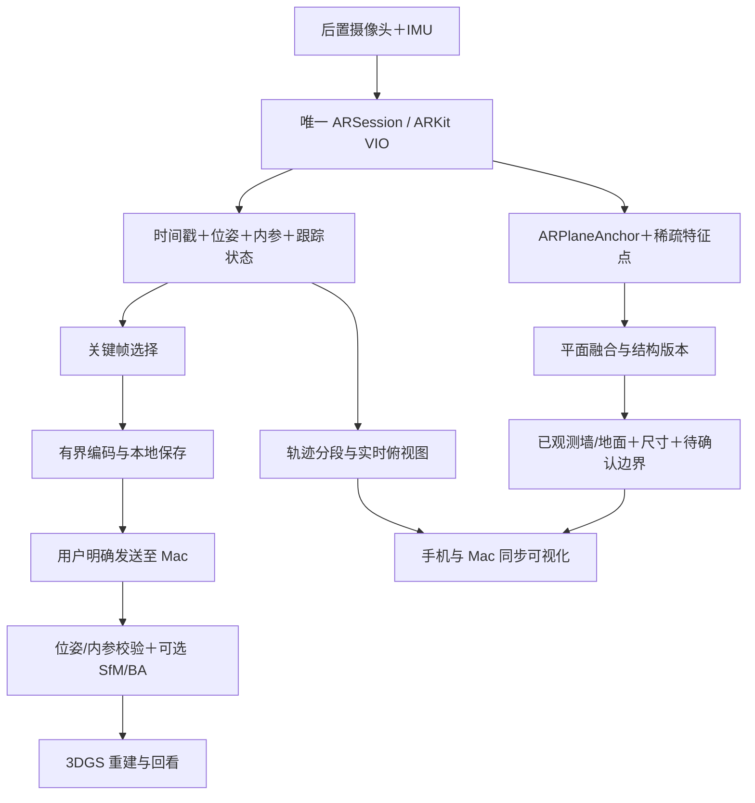

# VQASee 室内矢量空间：实时 SLAM、结构化建图与 3DGS 技术设计

日期：2026-10-09。状态：设计与一手资料调研完成；尚未实现、安装候选项目或进行真机算法评测。文中性能、精度、内存数字均为拟定验收目标或预算，不是实测结果。

2026-10-10 实施状态覆盖上述历史状态：A的采集/保存/真实Mac回放已实现，自动轨迹及独立图像一致性检查已接入。用户真实扫描1497姿态/198照片，图像检查20对中5对可测、15对不可可靠测量；A仍未完成原地转向噪声根因与修复验收。B完整语义房间结构和C真实3DGS均未完成。详细证据、修改与真实阻塞见 `docs/evolution/2026-10-10-spatial-quality-validation.md`，不要用单元测试替代阶段验收。

## 1. 产品目标和本轮裁决

帮助用户移动 iPhone 扫描一间房，实时看见自己走过的路线、已经观测的空间结构，最后得到能查看、测量、修改和保存的三维结构与俯视图。物品记忆不作为新设计的前提；不删除旧记录，也不把现有代码自动称为新能力。

本轮用户明确授权室内空间探索设计；它是独立探索方向，户外四项能力仍保留。第一阶段不承诺导航安全、完整建筑建模或测绘级尺寸，也不以逼真图片替代几何验收。

分三个阶段交付，不能把第一阶段草图说成完整矢量房间：

- A：实时位姿、运动轨迹、已观测水平/垂直平面、未知区域、保存与回放。目标是定位和观测闭环。
- B：稳定墙面 ID、真实边界证据、房间结构、尺寸与修正、门窗候选及确认。目标是结构化空间闭环。
- C：同一空间的关键帧与位姿导出、3DGS 重建与回看；随后探索碰撞代理和物理属性。

## 2. 只靠图像能不能做？

能，但应区分输入和产物：

| 输入 | 可以估计 | 主要限制 |
|---|---|---|
| 单张 RGB | 学习型深度、布局、三维候选 | 被遮挡处未知，尺度和背面依赖先验，不能称实测 |
| 连续单目 RGB＋视差 | 相机运动、稀疏/稠密几何 | 通常只有相对尺度；纯旋转、白墙、玻璃和动态物体困难 |
| RGB＋IMU | 视觉惯性定位、米制空间 | 尺度可观测依赖运动与标定；仍会漂移和失跟 |
| RGB＋IMU＋LiDAR | 深度支持的平面/表面重建 | 范围、遮挡、反光仍有缺口，额外硬件要求 |

首版采用 RGB＋IMU，由 ARKit 内部融合；不需要用户添加激光设备，也不是声称纯 RGB 已解决精确房间建模。Apple 说明其 world tracking 使用视觉惯性里程计。[ARKit 原理](https://developer.apple.com/documentation/arkit/understanding-world-tracking)

普通 iPhone 17 官方规格未列后置 LiDAR；RoomPlan 官方要求 LiDAR 设备。用户具体硬件能力仍以运行时探测为准，不从设备名字猜测。非 LiDAR 路线必须独立成立。[iPhone 17 规格](https://www.apple.com/iphone-17/specs/) · [RoomPlan 支持说明](https://developer.apple.com/videos/play/wwdc2022/10127/)

## 3. 四种表示：各司其职

| 表示 | 内容 | 用途 |
|---|---|---|
| 点云 | 离散 XYZ，可能带颜色/置信信息 | 重建证据、配准、诊断；不等于墙/门对象 |
| 网格 | 顶点与三角形 | 表面显示、碰撞代理；不自动包含语义 |
| 矢量/参数化结构 | 平面、多边形、门窗、房间及连接关系 | 测量、编辑、拓扑推理，是本产品核心 |
| 3DGS | 三维高斯的位置、形状、不透明度与外观系数 | 新视角逼真渲染；不直接提供物理属性 |

不是“把整幅画面画成线条”，也不是绕过几何估计。中间点云可以短期使用，再压缩成结构；不必把所有稠密点永久存储。结构通常较小，但关键帧和 3DGS 仍可能很大。

原始 3DGS 从已标定的多视角与稀疏点启动优化，再用高斯渲染新视角；实时渲染不等于实时训练。[3DGS 论文](https://arxiv.org/abs/2308.04079)

## 4. 技术栈和数据流

推荐端上 Swift/SwiftUI＋ARKit＋RealityKit；诊断与回放继续使用现有 Mac 闭环平台。Metal 仅在性能数据说明必要时进入主结构渲染，3DGS 展示另评估 MetalSplatter。



现有 IndoorMemoryController 已使用 ARWorldTrackingConfiguration、水平/垂直平面检测、相机变换及可选 sceneDepth，可以复用生命周期、捕获记录和调试接口；没有现成的完整房间结构图、轨迹渲染或 3DGS。

拟新增模块：SpatialScanCoordinator（唯一相机会话）、SpatialFrameSnapshot（元数据）、TrajectoryStore、PlaneObservationStore、VectorSpaceBuilder、SpatialScanView、SpatialScanStore、ReconstructionExport。命名是设计，不是当前已有文件。旧物品记忆不能与新扫描同时开相机。

### 4.1 实时定位与轨迹

使用 ARCamera.transform 的世界位置与姿态；不在第一版重写 SLAM。ARKit 内部地图与优化不可完全控制，rawFeaturePoints 是稀疏追踪证据，不是 LiDAR 点云或完整可导出的 SLAM 图。

轨迹采样草案：10Hz，移动 2cm 或转动 2°时可添加点；另保留低频静止心跳。阈值用于显示抽样，原始选定记录与失跟事件仍保存，不能用滤波抹掉实际跳变。两分钟采样约 1,200 点，可做分块折线而不是每点创建一个 RealityKit 实体。

tracking normal 才新增可信轨迹段；limited 状态保留最后位置并显示位置暂不可更新，标记中断。session reset 产生新 epoch，不能直接连成一条跨地图长线。重定位后只有确认坐标关系才合并历史段。地图保存是可选能力；无法恢复时允许建立新段，旧段作为历史独立保存。[会话恢复说明](https://developer.apple.com/documentation/arkit/managing-session-life-cycle-and-tracking-quality)

### 4.2 矢量结构：必须解决的算法

1. 优先读取 ARPlaneAnchor 的 transform、geometry 与更新事件，把 anchor 局部边界转换到统一世界坐标。几何边界只是当前观测范围，不是物理墙的完整外框。
2. 对多帧平面维护稳定结构 ID 与证据。合并同时检查法向夹角、平面距离、边界重叠和观测连续性；不能只靠法向相同就合并两面不相连的墙。
3. 稀疏点仅在支持足够时做 RANSAC 平面一致性检查；它们分布有偏，不能靠点少判断“此处没有墙”。有 sceneDepth 时才补充深度支持，不用伪深度替代测量。
4. 平面交线形成角点候选；墙脚投影到已确认地面生成二维线段。没有地面时不声称已得到有效平面图。缺角或遮挡处保持开放边界。
5. 做加权几何优化：最小化观测到平面的距离与多视图重投影误差，可选加入弱平行/垂直约束；先检测是否满足近似 Manhattan 假设，不强迫斜墙成直角。
6. 分离 observedBoundary、inferredBoundary 和 userEditedBoundary。人手拖出的边界仍标注人工修改，不回写成机器测量真值。

门窗是独立难点：二维语义分割/检测生成候选，多帧关联后用标定相机射线与已确认墙面交点估计边界，再检查尺度、视差和跨帧一致性。只看到黑色矩形不能认定是门；开口不代表能通行。无有效墙面或几何支持时只保留图像候选。不能仅依赖当前 Vision 前景分割。

RoomPlan 作为 LiDAR 支持路径，能提供参数化房间结构与实时更新，但仍需要与产品 schema、编辑历史和轨迹统一。使用公开能力检查和共享 ARSession 接口，避免两套摄像头竞争。[RoomPlan](https://developer.apple.com/augmented-reality/roomplan/) · [共享会话与多房间](https://developer.apple.com/documentation/roomplan/scanning-the-rooms-of-a-single-structure)

### 4.3 坐标和持久化契约

统一以米为单位、右手系、Y 向上；存储 T_world_camera（camera-to-world），ARKit 相机朝向 −Z。俯视图使用世界 X/Z 投影，并明确屏幕轴符号。不把 worldAlignment.gravity 当作绝对罗盘方向。

SpatialFrameSnapshot：frameID、timestamp、epoch、T_world_camera、K、imageWidth/Height、orientation、trackingState、mappingStatus；PlaneObservation：anchorID、timestamp、epoch、transform、localPolygon、alignment；VectorSurface：稳定ID、revision、来源列表、平面参数、边界、类别、证据状态；TrajectorySegment：epoch、起止时间、位姿点、失跟事件；Opening：hostSurfaceID、多边形、类别候选、证据与人工修改来源。

图片旋转、缩放、裁剪都要同步变换 K。导出到 OpenCV/COLMAP 的轴变换和矩阵求逆必须有已知三维点的投影测试。列/行主序、JSON 序列化与 viewer 读取要固定版本，禁止临时猜矩阵。

文件草案：manifest.json（schemaVersion/单位/坐标约定/epoch）、poses.jsonl、surfaces.json、events.jsonl、keyframes/、optional worldmap、可选 reconstructed splat 产物。每个产物存来源与版本、文件校验和；导出中断恢复和空间不足可见。默认本机受保护存储，用户可删除；图像传 Mac 和远端 GPU 必须分别明确授权。导出 JSON 是主结构格式，SVG 为平面图；USD/USDZ 由自有几何导出器实现，不能假装非 LiDAR 数据自动得到 RoomPlan 产物。

## 5. UI：实时看见自己如何建图

主屏不是点云播放器。默认保留实时摄像画面、结构线框和一个常驻俯视轨迹图，实时解释“正在观察哪里、还有哪里未知”。

```text
┌─────────────────────────────┐
│ 扫描空间          正在扫描   │
│                             │
│ 实时摄像画面                 │
│ 墙面半透明面片＋观测边界     │
│ 待确认边界使用虚线           │
│                             │
│ ┌────俯视图───────────┐    │
│ │ 已观测墙  起点●      │    │
│ │       ───轨迹──△方向 │    │
│ │ 空白＝尚未观测       │    │
│ └─────────────────────┘    │
│ 向旁边走两步，补充这个角落   │
│        [结束扫描]            │
└─────────────────────────────┘
```

俯视图稳定 north-up式本地参考方向（不是地理北），当前相机三角形显示朝向；点击展开为全屏三维轨迹/结构视图。相机原地转动时方向变化，路径不应凭空延长。轨迹在摄像主视图中可选显示，离开当前视野的轨迹仍能在俯视图看到。特征点为高级诊断开关，避免海量点抢占主体验。

结束后显示“三维结构 / 平面图”，点选墙查看尺寸与证据、拖动边界修正、保存空间。未知尺寸显示尚未测得，不显示 0 米。三维视图允许旋转/缩放，扫描时不让自由视角误导当前位置。动态人物不写入静态结构。

状态机：准备 → 初始化定位 → 扫描 ↔ 定位暂不可用/恢复中 → 整理结构 → 可查看 → 保存失败可重试。3DGS 独立状态：未生成/排队/重建/失败可重试/可查看。无需等待 3DGS 才能保存结构。

颜色草案：青色为已观测结构，橙色虚线为候选/待补扫，轨迹以实线和起点/朝向区分；同时使用文字、线型和符号，不能只靠颜色。任何进度百分比必须有真实定义，否则只提示“已观测 3 个面，边界尚未闭合”。

Mac 页面增加“空间扫描”会话视图：手机画面、三维结构/轨迹、同步时间轴和问题证据；浏览器采用 Three.js/WebGL 展示自有结构数据，3DGS viewer 后续单独适配。Codex 读取同一 schema 的位姿、tracking 事件、关键帧和错误摘要，不能仅凭好看的截图判断几何正确。

## 6. 3DGS 路线与物理属性边界

关键帧按清晰度、有效 tracking、位移/角度、视角覆盖选择，不按固定每帧保存。起始草案：0.5–2Hz、最长两分钟、最多240帧，按实际分辨率和存储预算调整；拒绝帧保留原因计数。预览和位姿不等待编码，有限队列拥塞时显示采集缺口。

保存 image＋同步 K/pose＋epoch＋曝光/质量可获得元数据＋可选深度。先做轴/投影检验，再检查重投影与覆盖；有需要时用 SfM/BA 精修。优化后的坐标通过公共关键帧估计 Sim(3) 与 ARKit 米制参考对齐，报告残差，误差大时不能叠加。不能把单目重建的任意尺度当米。

推荐顺序：原生 Mac 本地实验优先评估 Brush；OpenSplat 作备选；具备 NVIDIA CUDA 的工作站才评估 gsplat/原始实现。当前运行环境报告 x86_64，未确认可用 GPU，不能承诺 Apple Silicon 性能或本机训练耗时。Brush 的跨平台支持不保证本机硬件、浏览器或内嵌 WebView 可用，安装与小样本实际验证是关卡。[Brush](https://github.com/ArthurBrussee/brush) · [OpenSplat](https://github.com/WebODM/OpenSplat) · [gsplat](https://github.com/nerfstudio-project/gsplat)

手机后续只渲染压缩/分级的 splat，首个候选 MetalSplatter；它是渲染器，不是重建训练算法。Gaussian 数量、显存、文件大小与 GPU 帧耗时均需测量。3DGS 质量用保留未训练视角的渲染与几何对齐分别验收。[MetalSplatter](https://github.com/scier/MetalSplatter)

物理世界后续从确认墙面建立碰撞代理、从真实观测增加物体/材质/可移动性；质量、摩擦等属性需要显式先验、测量或交互验证。外观逼真不能自动推出可通行、碰撞准确或真实动力学。

## 7. 小马：论文与项目选型卡

以下是经过一手来源核对的候选，不声称覆盖所有最新研究，也不等于已在 iPhone 测试。

| 文献/项目 | 核心用途 | 本轮取舍 |
|---|---|---|
| [ORB-SLAM3 论文](https://arxiv.org/abs/2007.11898) / [官方代码](https://github.com/UZ-SLAMLab/ORB_SLAM3) | 视觉/视觉惯性、多地图定位 | 学习尺度、闭环与恢复；不先替换 ARKit，GPL及商业授权需核查 |
| [DROID-SLAM](https://github.com/princeton-vl/DROID-SLAM) | 学习型视觉 SLAM与优化 | 离线基线，GPU依赖与端上迁移需另验证 |
| [MASt3R-SLAM 论文](https://openaccess.thecvf.com/content/CVPR2025/papers/Murai_MASt3R-SLAM_Real-Time_Dense_SLAM_with_3D_Reconstruction_Priors_CVPR_2025_paper.pdf) / [代码](https://github.com/rmurai0610/MASt3R-SLAM) | 基于学习三维先验的单目稠密SLAM | 无LiDAR几何候选，先离线比较；论文实时性不能移植为iPhone承诺 |
| [VGGT 论文](https://arxiv.org/abs/2503.11651) / [代码](https://github.com/facebookresearch/vggt) | 多视图相机、深度、点与轨迹估计 | 关键帧离线补全候选，不能直接当长期因果SLAM或米制真值；代码/权重许可分别核对 |
| [DUSt3R](https://github.com/naver/dust3r) | 多视图 pointmap 与几何对齐 | 理解无标定图像重建，先研究不产品集成 |
| [3DGS论文](https://arxiv.org/abs/2308.04079) / [原始代码](https://github.com/graphdeco-inria/gaussian-splatting) | 高斯外观表示与快速渲染 | 后续重建基线；训练环境与使用许可不是默认已满足 |
| [Gaussian Splatting SLAM论文](https://arxiv.org/abs/2312.06741) / [MonoGS](https://github.com/muskie82/MonoGS) | 联合位姿跟踪和高斯建图 | 学习在线建图设计，不首版手机运行 |
| [2DGS](https://github.com/hbb1/2d-gaussian-splatting) | 表面导向的高斯与几何重建 | C阶段几何基线；更好的表面表示仍不直接给门窗语义 |
| [gsplat论文](https://arxiv.org/abs/2409.06765) / [代码](https://github.com/nerfstudio-project/gsplat) | CUDA高斯训练/渲染工具 | NVIDIA后端候选，普通Mac不默认可用 |
| [Brush](https://github.com/ArthurBrussee/brush) | 跨平台训练与查看，COLMAP/Nerfstudio输入 | Mac重建实验优先，需实际GPU与兼容性测试 |
| [OpenSplat](https://github.com/WebODM/OpenSplat) | Mac/Windows/Linux重建实现 | 备选，AGPL及集成方式独立审查 |
| [MetalSplatter](https://github.com/scier/MetalSplatter) | Apple平台Metal高斯渲染 | iOS展示候选，渲染不等于训练 |

结论：ARKit 是首版定位底座，几何/语义结构由自有 builder 负责；学习型重建解决候选几何但不直接替代尺度与房间结构验收。3DGS 独立迭代。采纳级别：ARKit设计路线、几何builder为L2待实验；学习SLAM、3DGS方案为L1/L2，不是L4生产落地。查明版本和许可证之后才冻结依赖，不在本设计阶段安装整套项目。

## 8. 性能与缓冲预算

三条队列分离：位姿/anchor元数据优先、结构与模型低频、关键帧编码/落盘有界。相机会话不同时运行户外模型和所有离线模型。初始目标：预览/轨迹显示≥30fps，pose-to-screen p95≤100ms，结构更新2–5Hz，结构处理p95≤200ms；正式预算按iPhone17实测修订，失败明确记录，不能放宽门槛宣称达标。

位置快照是小型数值数据；显示轨迹不需要像素复制。模型读取源 CVPixelBuffer 时限制持有数量与时间；关键帧需要长久保存时一次必要编码或缩放到 App 所有缓冲后及时释放系统源。不能因最近取消 deepCopy 就无限留帧等待重建。CPU→GPU也不是当然零复制，Metal纹理视图与命令完成生命周期应独立审查。

诊断记录每帧关联ID、tracking状态、pose采样与显示时间、模型耗时、编码耗时、队列年龄、丢弃原因、关键帧缺口、保存/传输状态、thermalState。目标预算：轨迹和观测结构10MB内，显示稀疏点初始限5,000；原始图像及splat单独计费到存储预算，不混入“矢量模型很小”的宣传。

## 9. 验收：真实房间与公开序列并用

先用家中单房间，书店/咖啡店在允许拍摄且少动态干扰时补充。卷尺测墙间距离、门宽；手机绕房间返回起点、原地转身、经过同一门框。至少包含白墙、玻璃、暗光、快速转向、重复走廊、遮挡和中断恢复；所有尝试都计入失败率。

| 门 | 起始验收目标（尚未实测） | 证据 |
|---|---|---|
| 轨迹UI | 原地转动不生成虚假长路径；失跟不连跨地图线 | 手机录屏＋pose/events回放 |
| 轨迹漂移 | 20m实测闭环终点误差≤0.3m | 已知起终点；不做尺度拟合来掩盖误差 |
| 尺寸 | 已确认墙距误差≤max(10cm,5%) | 卷尺对照，列出未确认/失败项 |
| 结构 | 未观测处保持未知；墙面错误合并可复现并修正 | 多视角原图＋结构ID/版本 |
| 性能 | pose-to-screen p95≤100ms，持续10分钟无无界增长 | 真机计时、内存、温升与全部丢帧 |
| 导出 | 重读后pose、墙面和相机投影一致 | Schema往返与已知点投影测试 |
| 3DGS | 未训练视角外观＋米制结构对齐分别通过 | held-out图、渲染、对齐残差；门槛在C实验定义 |

公开序列用于算法比较不替代端上相机压力和UI验收；可后续使用EuRoC/TUM-VI做VIO对照，其数据与适配尚未本轮下载验证。几何误差、帧率和用户可理解性必须一起达标。

## 10. 角色审查、任务卡与实施顺序

乔布斯：同意分阶段，但B的边界与尺寸是矢量产品成立的必要能力，不能永久留成草图demo。A作为实验交付明确标注。

罗根/全麦：独立技术审查有条件同意；要求米制精度实测、epoch断段、内参/轴转换测试、anchor更新证据及GPU环境核验。已纳入上述设计。

思余：本方案UI视角有条件同意；主屏必须常驻轨迹，定位失败不继续动画假装移动，不用大量点替代可理解结构。尚未独立执行UI原型或真实看图验收。

小马：同意ARKit先行、学习几何离线比较、3DGS分层；不把论文GPU实时性当成手机实时性。乔布斯最终裁决：A先验证定位与可视化，B形成可编辑空间，C加外观；普通设备路径优先，LiDAR是增强路径。

| 主责 | 配合 | 改动范围/交付 | 验收 |
|---|---|---|---|
| 罗根 | 思余 | 唯一session、元数据/epoch、有界队列、诊断 | 10分钟、失跟恢复、切换相机、真实持有时间 |
| 思余 | 罗根/乔布斯 | 实时AR平面、常驻俯视轨迹、结果编辑页 | 手机实际操作录屏，未知/失败清晰 |
| 全麦 | 罗根/小马 | 平面融合、结构优化、门窗候选与多视图几何 | 尺寸/覆盖/误合并/门窗定位同场景测量 |
| 小马 | 全麦 | 固定小样本对比ARKit、学习重建、Brush/其他后端 | 安装成功、输入契约、耗时/内存/几何与外观结果 |
| 乔布斯 | 全体 | 用户旅程、真实功能与场景验收、发布裁决 | 从扫描到保存到重开回看全部走通 |

接口联调：先冻结snapshot/schema/epoch和坐标，再用同一手机会话打通手机UI→本地保存→Mac回放；后续结构与splat依赖同一frameID，不各自猜姿态。新增依赖时同步setup_mac.sh、对应requirements/部署脚本和README；本轮仅文档无依赖变化。

实施顺序：A1 capability＋轨迹快照与显示；A2平面显示＋状态恢复＋保存回放；B1结构融合＋尺寸/编辑；B2门窗与拓扑；C1关键帧导出＋小规模重建；C2手机/Mac splat展示。每步必须有用户实际看到的画面和同场景复测，再进入下一步。

本轮仅完成设计文档与技术调研，不开始产品coding、不删除物品记忆、不修改当前默认入口；上述实施属于后续开发范围。剩余真实依赖：设备能力、iPhone17房间采集、Mac GPU/驱动确认；未知结构精度和重建耗时保持未验证。
